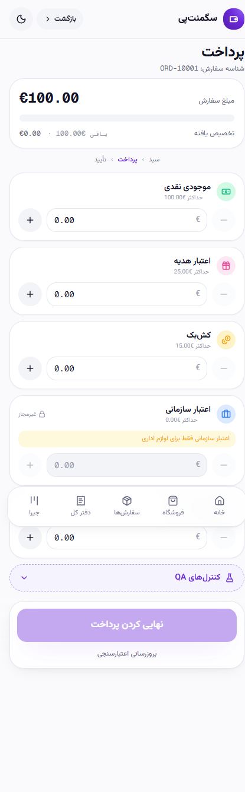
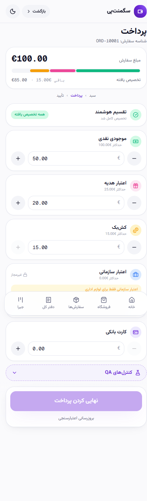
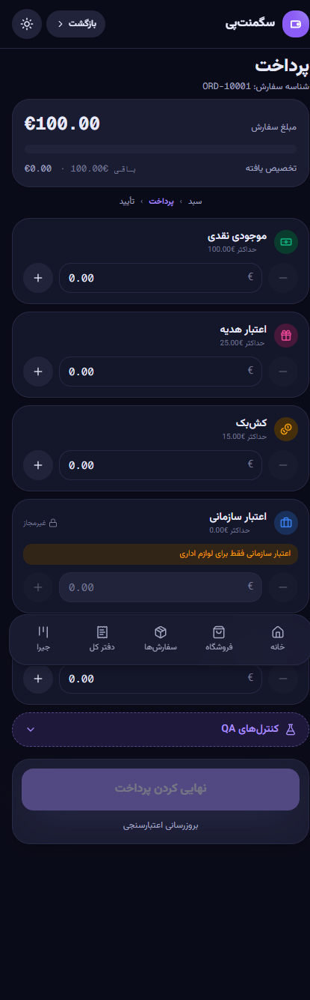

# SPAY-113 · Smart split — one-tap allocation across eligible sources

**Status:** TODO · **Priority:** HIGH · **Route:** `/checkout/:orderId`

## User story

As a shopper paying a multi-wallet order, I want a single "تقسیم هوشمند" (Smart Split) button that fills every allocation input for me so that I don't have to do arithmetic across five sources to finalize a payment.

_FA:_ به عنوان یک خریدار که از چند منبع پرداخت می‌کنم، می‌خواهم یک دکمه «تقسیم هوشمند» همه مبالغ تخصیص را به‌صورت خودکار پر کند تا مجبور نباشم بین پنج منبع محاسبه دستی انجام دهم.

## Description

Checkout today requires the user to type an amount into each of up to five payment-source inputs until the allocated total matches the order total. For a €100 order on a fresh wallet the shopper performs 3–5 input events before the finalize button becomes enabled. This ticket adds a **Smart Split** affordance that computes a valid allocation and writes it to the existing input state in one click.

**Algorithm — biggest-balance-first, eligibility-aware:**

1. Request a fresh quote with empty allocations so the latest `eligibility[].maxCents` per source is known.
2. Build the candidate list of non-card sources where `getMaxForSource(source) > 0`, sorted by `maxCents` descending.
3. Walk the list, draining each source: `take = min(remaining, maxForSource)` → write to `allocations[source]`, subtract from `remaining`.
4. Any leftover `remaining` after wallets are exhausted is assigned to `card`.
5. If `remaining === 0` **and** no sources were used, fall back to an all-card allocation (card is always eligible for the full total).

The algorithm is deterministic and pure — same wallet + eligibility + total always yields the same split.

_FA:_ پرداخت امروز از کاربر می‌خواهد در هر یک از پنج ورودی منابع پرداخت مبلغی وارد کند تا جمع تخصیص‌ها با مبلغ سفارش برابر شود. این تیکت دکمه «تقسیم هوشمند» را اضافه می‌کند که با یک کلیک یک تخصیص معتبر محاسبه و در ورودی‌های موجود می‌نویسد.

## Design

Mockups rendered on the real `/checkout/:orderId` surface at 430×900 (iPhone 14 Pro width) using the production component library. Source PNGs live in `designs/SPAY-113/`.

### Light mode

| 1. Before (today) | 2. Smart Split — idle | 3. Smart Split — complete |
| :---: | :---: | :---: |
|  |  |  |

### Dark mode

| 4. Before (today) | 5. Smart Split — idle | 6. Smart Split — complete |
| :---: | :---: | :---: |
|  |  |  |

### Placement

A new button rendered **above the segment allocation rows**, below the stepper breadcrumb, inside a dedicated row card so it reads as a utility — not a primary CTA.

```
┌─ Order hero card ─────────────────────────┐
│  مبلغ سفارش                   €100.00     │
│  ████████░░░░░░░░░░░░░░ allocation bar    │
│  تخصیص یافته                   €0.00      │
└───────────────────────────────────────────┘
          سبد  ›  پرداخت  ›  تأیید

┌─ NEW: Smart Split row ────────────────────┐   ← added by this ticket
│  ✨ تقسیم هوشمند          [🪄 پر کردن خودکار]│
│     بر اساس موجودی و قوانین واجد شرایط    │
└───────────────────────────────────────────┘

┌─ Allocation rows (unchanged) ─────────────┐
│  💵 موجودی نقدی    حداکثر €120  [− 0 +]   │
│  🎁 اعتبار هدیه    حداکثر €25   [− 0 +]   │
│  ...                                      │
└───────────────────────────────────────────┘
```

### Visual spec

- Card: `rounded-3xl bg-surface border border-hairline shadow-sm2 p-3.5` (matches allocation-row cards for visual continuity).
- Leading icon: `<Sparkles size={16}>` wrapped in `h-8 w-8 rounded-2xl bg-brand-soft text-brand` (reuses `SegmentIcon`-sized slot).
- Title: `text-sm font-semibold text-text` — «تقسیم هوشمند».
- Subtitle: `text-[10px] text-soft` — «بر اساس موجودی و قوانین واجد شرایط».
- CTA: `<Button intent="secondary" size="sm">` containing `<Wand2 size={14}>` + text «پر کردن خودکار».
- State — disabled with pill «همه تخصیص یافته» when `remaining === 0`.
- State — if the row is tapped and no eligible source has balance (impossible unless card is also disabled), fall back to writing full total to `card`.

### Motion

- On click, the five `CurrencyInput`s receive values in a 60 ms-staggered waterfall (cash → gift → cashback → corporate → card) via sequential `setAllocations` calls wrapped in `requestAnimationFrame`. The existing `CurrencyInput` already animates the number display, so no new animation code is needed.
- The `AllocationBar` ride-along is automatic — it's already a motion component watching `allocations`.
- The finalize button's enable-transition is the existing Tailwind `transition-all`.

### Dark-mode

No new tokens. All classes already have dark variants.

## Preconditions

- Order ORD-X exists with total `€100.00`.
- Wallet has at least one eligible non-card source with positive balance (so Smart Split demonstrates the non-trivial path).
- Quote has resolved — eligibility is in state before the user clicks.

## Acceptance criteria (Given / When / Then)

**AC-1 — Fills exactly to total on grocery order with full wallet**

- Given a fresh €100 grocery order on the seeded wallet (cash=120, gift=25, cashback=15, corporate=90)
- When the user opens `/checkout/:id` and clicks `checkout-smart-split-button`
- Then within 500 ms the five inputs hold values such that their sum equals `totalCents` and `checkout-finalize-button` becomes enabled

**AC-2 — Respects eligibility**

- Given a €49.90 electronics order (cashback and corporate are ineligible per existing rules)
- When the user clicks `checkout-smart-split-button`
- Then `allocations.cashback === 0` and `allocations.corporate === 0`, and the remainder is covered by cash + gift + card

**AC-3 — Falls back to all-card when wallets are empty**

- Given a reset wallet (all segments zero) and a €5 grocery order
- When the user clicks `checkout-smart-split-button`
- Then `allocations.card === 500` and all other sources are `0`

**AC-4 — Disabled when already fully allocated**

- Given the user has manually filled inputs so `allocatedTotal === totalCents`
- When the Smart Split row renders
- Then `checkout-smart-split-button` has attribute `disabled` and a `checkout-smart-split-complete` chip is visible

**AC-5 — Idempotent**

- Given Smart Split has been clicked once
- When the user clicks it a second time
- Then the allocations do not change

## Scenarios

**Happy path:** €100 grocery order on seeded wallet → click Smart Split → fields fill 50/20/15/15/0 (cash/gift/cashback/corporate/card) → finalize enables → pay succeeds → `/payment-result/:id` shows success.

**Negative / edge:**
- Electronics order where only cash, gift, and card are eligible → Smart Split fills from cash/gift first, remainder to card; ineligible rows stay at 0 with their existing lock badge.
- Order larger than wallet → wallets drained to 0, residual goes to card.
- Quote hasn't resolved yet (eligibility empty) → button is disabled with subtitle «در حال بارگذاری اعتبارسنجی...».

## Expected results

- One click; finalize enables; happy-path Playwright flow completes without any `.fill()` calls on the five amount inputs.
- No change to backend `/api/orders/:id/pay` — only UI composes the allocation.
- No change to existing E2E tests — Smart Split is additive; the current manual-entry tests still cover the manual path.

## data-testid contract

- `checkout-smart-split-button` — the Button element inside the Smart Split row
- `checkout-smart-split-complete` — pill shown when `allocatedTotal === totalCents` and Smart Split would be a no-op
- Existing inputs `checkout-allocation-{cash,gift,cashback,corporate,card}` are **unchanged** — Smart Split writes into them via the existing `handleAllocChange` state setter so no new input testids are needed

## Out of scope

- Persisting the user's preferred split across sessions (that's a future SPAY-114 "saved presets" ticket).
- Alternate strategies (cheapest-first, equal-split, prefer-cashback). Only biggest-balance-first ships here; a strategy picker is a future enhancement.
- Changing the server-side quote/pay contract. The feature is entirely front-end.

## Rollout notes

- Pure UI; no migration, no feature flag, no API change.
- Add `smartSplit(totalCents, wallet, eligibility)` as a pure function in `apps/web/src/lib/smart-split.ts` with a Vitest unit test covering the three branches (full-wallet, partial-eligibility, empty-wallet). The React component just calls it and feeds the result into `setAllocations`.
- Dev agent must not introduce `window.alert`, `console.log`, or any mutation of the existing allocation state outside `setAllocations`.
- QA agent writes `tests/e2e/smart-split.spec.ts` covering AC-1, AC-2, AC-3; regenerates evidence via `zz-evidence.spec.ts` with a new step `SPAY-113-step-1-smart-split-filled.png`.
